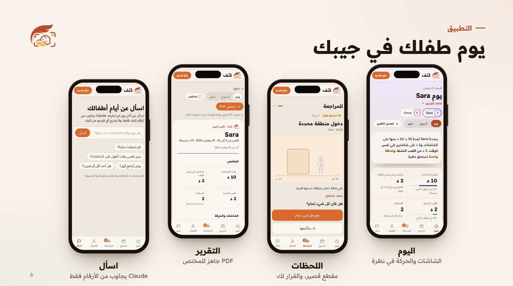

<h1 align="center">Kanaf · كَنَف</h1>

<p align="center">
  <b>Your child's day, clearly.</b><br>
  A home camera turned into one simple dashboard for parents: screen time, movement, and safety alerts.
</p>

<p align="center">
  <a href="https://kanaf-sa.vercel.app"><b>Live app</b></a> ·
  <a href="https://ahmed-log-kanaf-api.hf.space/docs">API docs</a>
</p>

<p align="center">
  
</p>

---

## The problem

Working parents can't watch their kids all day. They don't know how many hours went to screens, whether the child moved at all, or if something dangerous happened while nobody was looking. Existing baby monitors only show a live feed, so the parent still has to watch it.

## What Kanaf does

Kanaf watches the camera feed and turns it into a summary of the day:

- **Screen time on every screen.** TV, tablet and phone, including when the child uses more than one at once.
- **Movement.** How active the child was across the day, and the long still stretches.
- **Safety alerts.** Falls, entering a danger zone (like the kitchen or the stairs), and violent contact between kids, each saved as a short clip for the parent to review.
- **A PDF report** of the day, ready to share with a specialist.
- **Ask.** Parents ask questions about their kids' days in plain language. Claude answers from Kanaf's numbers only, and no video ever leaves Kanaf.

The parent opens one dashboard instead of rewatching hours of video.

> For the demo you upload a video. In a real home it would be a live camera feed. The pipeline is the same for both.

## How it works

```
Video → YOLO11 detection + pose + tracking → per-second states → smoothing → daily report → dashboard
```

| What | How |
|---|---|
| People, TV, phone, cup | YOLO11 (pretrained) |
| Tablet | YOLO11 fine-tuned for tablets |
| Body keypoints | YOLO11-pose |
| Following each child | ByteTrack |
| Screen use, movement, danger zones | Rules on detections and keypoints |
| Falls | Rules on keypoints |
| Violent contact | Classifier trained on RWF-2000 |

The models look and the rules decide, so the behavior is easy to tune. Training went to the two places that needed it: the tablet detector and the violence classifier. Everything runs at 2–3 frames per second on a free CPU.

**Stack:** React + Vite + Tailwind on Vercel · FastAPI in Docker on Hugging Face Spaces · Supabase (Postgres + clip storage) · CI that tests the backend and deploys it automatically.

## Privacy

Kanaf never stores the full video. It keeps the timeline and short alert clips only. It reports what happened, not judgments about the child, and every alert is for a parent to review, not a verdict.

## Team

Built in 5 days as the final project of the Computer Vision course at Tuwaiq Academy.

| | Role |
|---|---|
| **Ahmed Alluqmani** · [@Ahmed-log11](https://github.com/Ahmed-log11) | Idea and product. Frontend, backend API, database, integration, deployment, code review |
| **Sulaiman Allumaylim** · [@Suliman41](https://github.com/Suliman41) | Perception: detection, pose, tracking, screen state, movement |
| **Nouf** · [@nnnoufff](https://github.com/nnnoufff) | Safety: violent contact, falls, danger zones |
| **Basma Almuntaser** · [@Basmaalmuntaser](https://github.com/Basmaalmuntaser) | Data and evaluation: tablet model, demo video, ground truth, results |

## Run it yourself

```bash
cp .env.example .env
docker compose up --build
```

Frontend at `localhost:5173`, API docs at `localhost:8000/docs`. More detail is in [`docs/`](docs/): the API contract, architecture and deployment.
